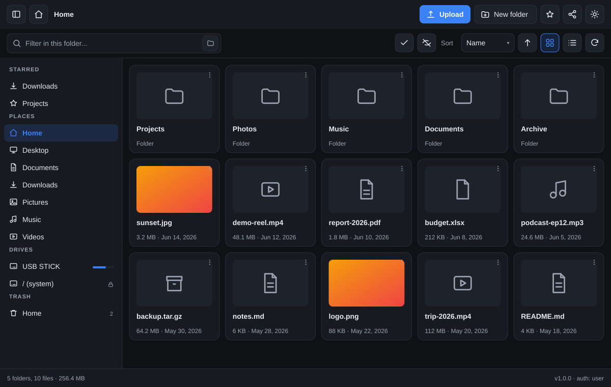
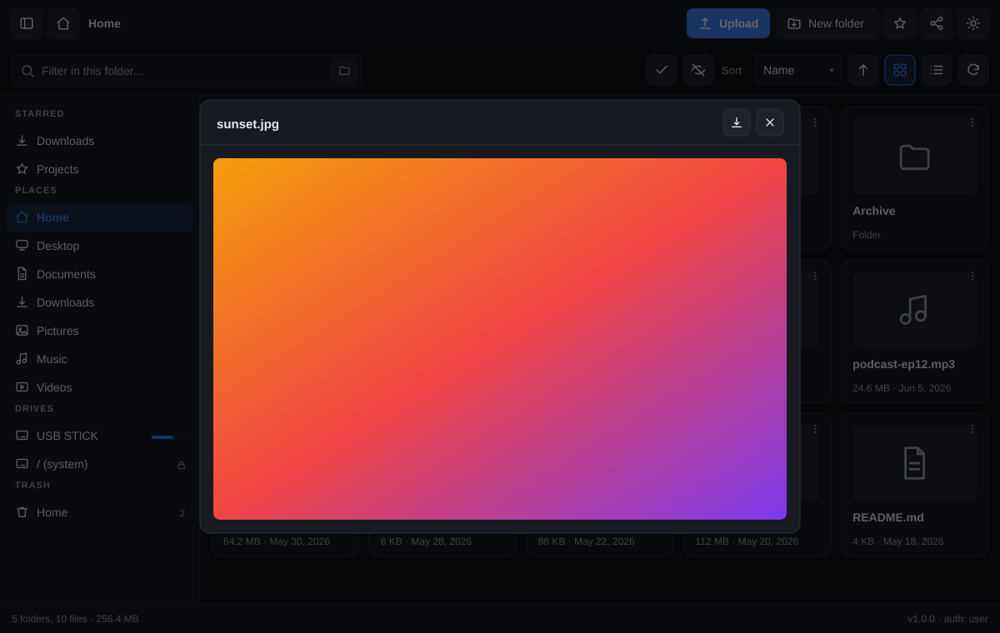
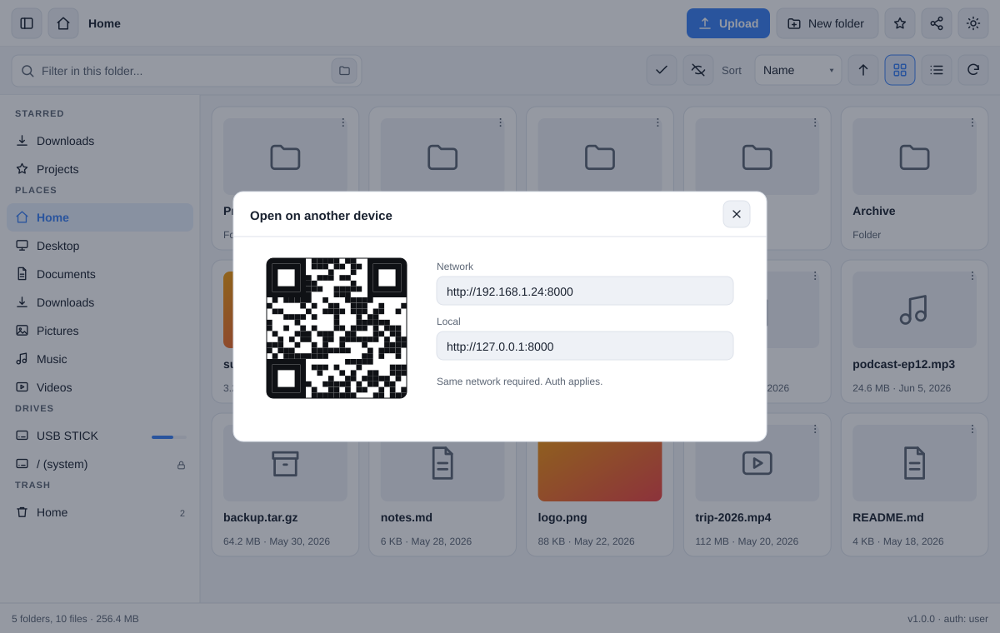

<p align="center">
  
</p>

<h1 align="center">local-file-webserver</h1>

<p align="center"><strong>Share any folder in one command. Zero dependencies. No install, no build, no fuss.</strong></p>

<p align="center">
  <a href="https://www.python.org/"></a>
  
  
  
  <a href="LICENSE"></a>
</p>

---

A tiny, dependency-free file server with a polished web UI. Point it at a folder
and browse, preview, upload, search, rename and delete files from any browser on
your machine or local network — with a sidebar for quick navigation to your home
folders and mounted drives.

It is a **single `python3 serve.py` away** from a working file share. Everything
runs on the Python standard library: no `pip install`, no build step, no
framework, no `node_modules`. The front end is plain HTML/CSS/JS served straight
from `fileserver/static`.

## 🖼️ Screenshots

| Browse | Preview | Share on your phone |
| --- | --- | --- |
|  |  |  |

## ✨ Highlights

- **Zero dependencies** — pure Python standard library, no install step
- **One command** to serve any folder; defaults to your home directory
- **Closable sidebar** — Starred, Places (Home/Desktop/Documents/Downloads/
  Pictures/Music/Videos), Drives and Trash
- **Rich previews** in the browser: images, video, audio, PDF and text/code
- **Drag-and-drop uploads** with per-file progress
- **Recursive search** across a folder or the whole subtree
- **Soft-delete** to a restorable `.trash` folder (on by default)
- **Star/pin folders**, persisted server-side
- **Bulk select** with one-click ZIP download; download any folder as ZIP
- **Mounted drives** in the sidebar with capacity bars and lock states
- **HTTP `Range`** support so audio/video seeking just works
- **Optional password** protection (HTTP Basic auth)
- **LAN sharing** panel with a built-in QR code generator
- **Read-only mode**, hidden-file toggle, light/dark theme, keyboard shortcuts
- Configurable with a commented `config.ini` **and/or** command-line flags

## 🚀 Quick start

```bash
git clone <your-fork-url> local-file-webserver
cd local-file-webserver
python3 serve.py
```

That's it. The server prints a `Local:` URL plus a `Network:` URL (and a random
password, unless you disable auth). Open it and you're browsing your home
directory.

Prefer a specific folder?

```bash
python3 serve.py ~/Downloads
python3 serve.py ./public --port 9000
python3 serve.py ./docs --localhost --password hunter2
```

`python3 -m fileserver` is an equivalent invocation, and individual modules can
be run directly too (they bootstrap the package automatically).

> **No dependencies at all?** Correct. There is nothing to install — if you have
> Python 3.8+ you already have everything needed.

## 🔧 Usage

| Flag | Description |
| --- | --- |
| `directory` | Folder to serve (default: your home directory) |
| `--config PATH` | Config file to load (default: `./config.ini` if present) |
| `-p`, `--port` | Port to listen on (default `8000`; `0` picks a free port) |
| `--host` | Address to bind (default `0.0.0.0`, i.e. LAN-accessible) |
| `--localhost` | Bind to `127.0.0.1` only (no LAN access) |
| `--user` | Username for Basic auth (default `user`) |
| `--password` | Enable auth with a fixed password |
| `--no-auth` | Disable authentication (even if a password was supplied) |
| `--read-only` | Disable upload, delete, rename and mkdir |
| `--show-hidden` / `--no-show-hidden` | Show/hide dotfiles (default: hide) |
| `--trash` / `--permanent-delete` | Soft-delete to `.trash` (default) or erase |
| `--drives {accessible,locked,unlocked}` | How non-removable filesystems are exposed |
| `--no-drives` | Do not detect or list mounted drives |
| `--root PATH` | Extra root to expose (repeatable) |
| `--no-qr` | Hide the LAN QR code in the UI |
| `--open` | Open the browser after starting |
| `--quiet` | Suppress per-request logging |
| `--version` | Print the version and exit |

```bash
# Read-only public share on a custom port
python3 serve.py ./public --read-only --no-auth --port 8080

# Expose an extra data directory alongside home
python3 serve.py ~ --root /srv/files --root /data/shared

# Unlock every mounted filesystem in the sidebar
python3 serve.py --drives unlocked
```

## ⚙️ Configuration

A commented [`config.ini`](config.ini) ships next to `serve.py` and is loaded
automatically. Every option is commented out by default, so the file documents
itself. **Precedence: command-line flag > config file > built-in default.**

```ini
; directory = ~

[server]
; host = 0.0.0.0
; port = 8000
; read_only = false
; quiet = false

[auth]
; user = user
; password =            ; empty -> auto-generate; "none" -> disable auth

[files]
; show_hidden = false
; trash = true

[drives]
; mode = locked         ; accessible | locked | unlocked
; enabled = true
; roots = /srv/files, /data/shared

[trash]
; dirname = .trash

[favorites]
; file =
```

Keep personal overrides (which may contain a password) out of version control by
using a separate file: `python3 serve.py --config config.local.ini`. The
`.gitignore` already excludes `*.local.ini`.

### Drive modes

- `accessible` — list only home + removable drives; other filesystems are hidden
- `locked` — list all real filesystems, but non-removable ones appear locked
  (default; unlock them with `--drives unlocked` or expose them via `--root`)
- `unlocked` — list all real filesystems and allow navigating all of them
  (prints a startup warning)

## ⌨️ Keyboard shortcuts

| Key | Action |
| --- | --- |
| `Backspace` | Go to the parent folder |
| `F2` | Rename the focused item |
| `Delete` | Delete the focused item (moves it to trash) |
| `/` | Focus the search box |
| `Esc` | Close menus and dialogs |

## 🔒 Security

- **Plain HTTP only.** Generating a self-signed certificate would require
  third-party libraries, so traffic is unencrypted and Basic-auth credentials
  are sent in cleartext. Use it on a trusted local network, and prefer
  `--localhost` when you don't need LAN access.
- The server only accepts opaque **root keys** from clients; every request is
  confined to the resolved root via `realpath` containment checks, and symlinks
  that point outside a root are rejected.
- Serving your home directory (the default) or unlocking all drives exposes those
  files. Use `--read-only`, `--password`, or a narrower `directory` for shares.
- The favorites file is written with mode `600`.

## 📡 HTTP API

<details>
<summary>Endpoint reference (click to expand)</summary>

All endpoints require Basic auth when a password is configured. Paths are
relative to the selected root (default `home`); a `root` query parameter selects
another accessible root. Paths that resolve outside their root are rejected.

| Method | Endpoint | Purpose |
| --- | --- | --- |
| `GET` | `/api/info` | Server info, LAN/local URLs, flags |
| `GET` | `/api/places` | home, places, drives, trash |
| `GET` | `/api/list?root=&path=&hidden=` | Directory listing (JSON) |
| `GET` | `/api/search?root=&path=&q=&hidden=&limit=` | Recursive search |
| `GET` | `/api/download?root=&path=` | Download a file, or a folder as `.zip` |
| `GET` | `/api/raw?root=&path=` | Inline content (used for previews) |
| `POST` | `/api/archive` | JSON `{root, paths[]}` → ZIP of a selection |
| `POST` | `/api/upload?root=&path=&name=[&overwrite=1]` | Upload raw body |
| `POST` | `/api/mkdir?root=&path=&name=` | Create a directory |
| `POST` | `/api/rename?root=&path=&name=` | Rename a file or folder |
| `POST`/`DELETE` | `/api/delete?root=&path=[&permanent=1]` | Soft-delete (or erase) |
| `GET` | `/api/favorites` | List starred folders |
| `POST`/`DELETE` | `/api/favorites?root=&path=[&label=]` | Add/remove a star |
| `GET` | `/api/trash?root=` | List trash |
| `POST` | `/api/trash/restore?root=&id=` | Restore a trashed item |
| `POST` | `/api/trash/empty?root=[&id=]` | Empty trash, or delete one item |

Uploads send the file as the raw request body (`Content-Length` required) with
the target location in the query string — no multipart parsing needed.

</details>

## 🧪 Tests

```bash
python3 -m unittest discover -s tests -v
```

The suite covers authentication, path-traversal and symlink-escape rejection,
listings and hidden-file filtering, multi-root selection and locked roots,
recursive search, range requests, uploads/overwrites, mkdir/rename, soft-delete
round-trips (restore/empty), folder and selection ZIP archives, favorites, and
read-only mode.

## 🧩 Requirements

- Python **3.8+** (uses only the standard library)
- Any modern browser
- Linux, macOS or Windows

## 🗂️ Project layout

<details>
<summary>Repository tree (click to expand)</summary>

```
serve.py                     CLI entry point (thin wrapper)
config.ini                   Commented default configuration
PROPOSED.md                  Design notes for the sidebar/config feature set
fileserver/
  __main__.py                `python3 -m fileserver` entry point
  cli.py                     Argument parsing, config merge and startup
  settings.py                config.ini loading + root/drive assembly
  config.py                  Runtime configuration and Root model
  server.py                  HTTP server, request handler, routing
  routes.py                  API handlers
  security.py                Basic auth
  places.py                  Home dirs and mounted-drive discovery
  favorites.py               Starred-folder store
  trash.py                   Soft-delete (trash) support
  archive.py                 On-demand ZIP building
  fsutil.py                  Path safety, listings, search, mime types, ranges
  static/
    index.html               SPA shell + SVG icon sprite
    css/style.css            Responsive themes + sidebar
    js/app.js                UI logic
    js/qrcode.js             Minimal QR encoder (byte mode, ECC level L)
tests/test_server.py         unittest smoke tests
docs/screenshots/            UI images used in this README
```

</details>

## 📄 License

Released under the [MIT License](LICENSE).
